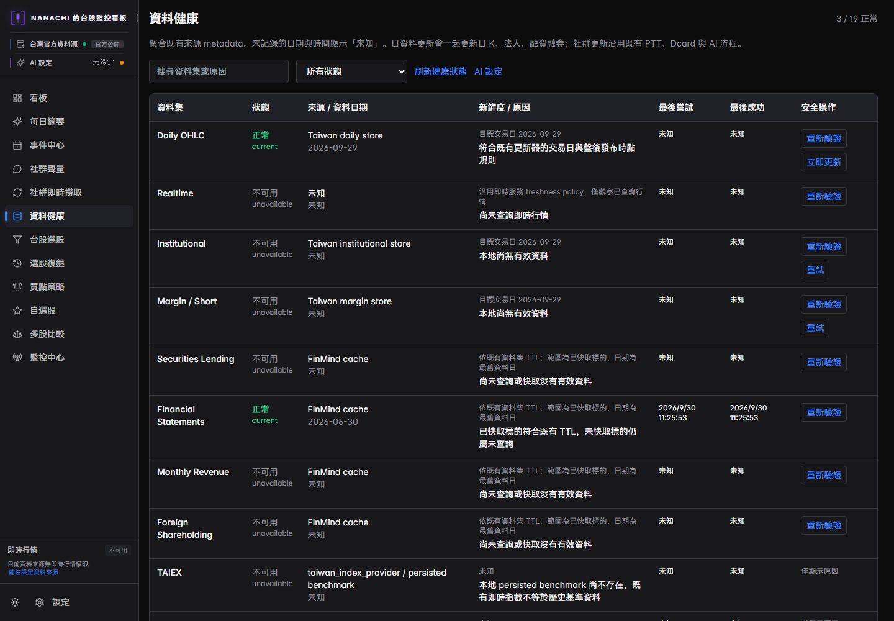
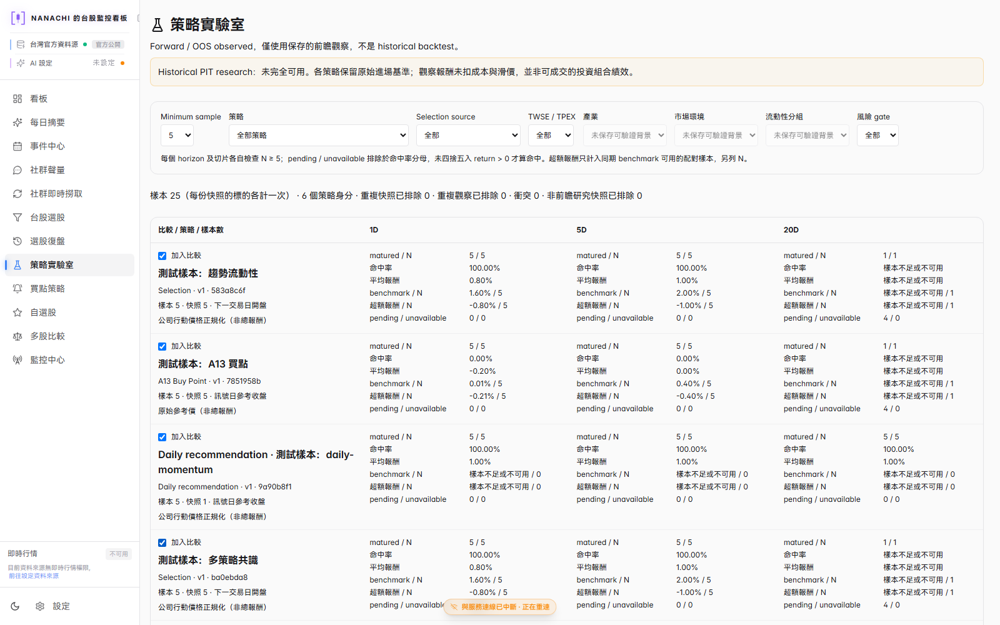
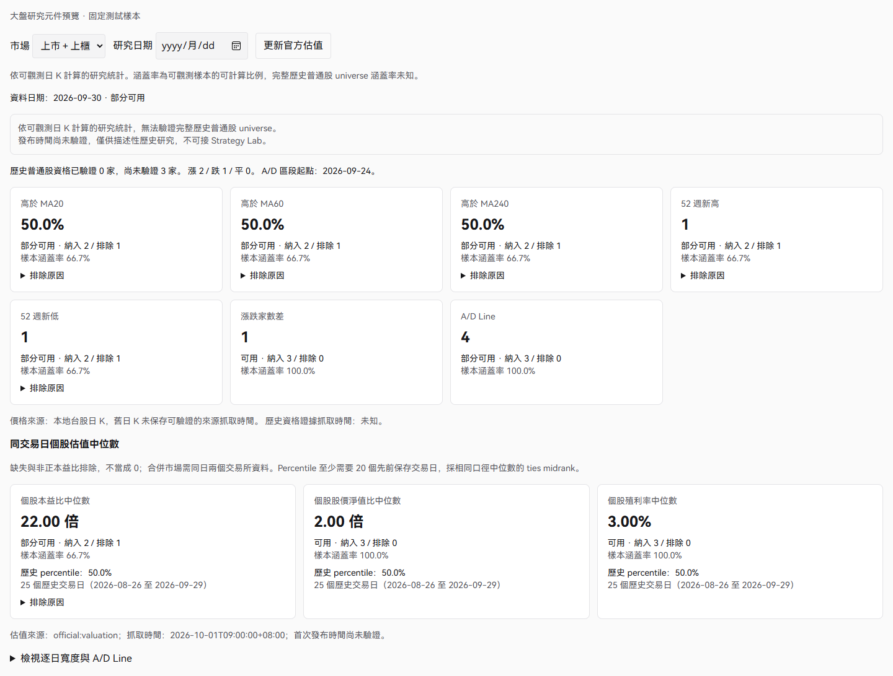

# 台股功能截圖

以下為本專案既有台股功能的示意圖。畫面擷取時的資料日期、範例數值與側邊欄可能和目前版本不同；實際操作請參閱[操作說明書](../docs/操作說明書.md)。

## 資料健康

檢查資料集的來源、資料日期、可用狀態與更新結果。詳細說明見[資料健康中心](../docs/data-health-center.md)。

## 策略實驗室

查看台股量化策略的研究與驗證結果。詳細說明見[策略實驗室](../docs/strategy-lab.md)。

## 大盤研究

查看台股市場廣度與估值資料。詳細說明見[操作說明書](../docs/操作說明書.md)。

